# Theme palettes — set 2

The first set was all the same cool dashboard look. This set is meant to look **designed**, not like Vercel/Linear/GitHub.

**See the colors:** [http://localhost:5173/theme-palettes.html](http://localhost:5173/theme-palettes.html)

Reply with two IDs, for example: `Light A + Dark A`.

---

## Light

### Light A — Cream + electric indigo

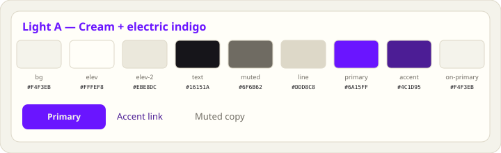

Warm paper, one loud indigo. **Pair:** Dark A.

---

### Light B — Bone + forest

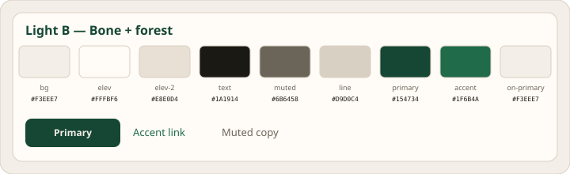

Deep green on bone. Cartographic, not traffic-light green. **Pair:** Dark B or Dark G.

---

### Light C — Fog + lime

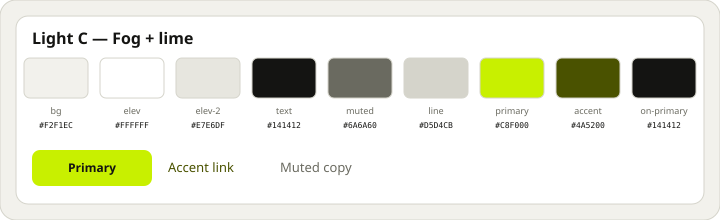

Black type, lime punch. **Pair:** Dark B.

---

### Light D — Stone + lake

Warm stone, deep lake. **Pair:** Dark D.

---

### Light E — Porcelain + wine

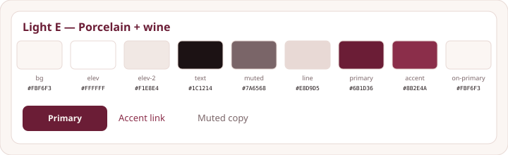

Burgundy, not orange, not Mac red. **Pair:** Dark E.

---

### Light F — Clay + indigo ink

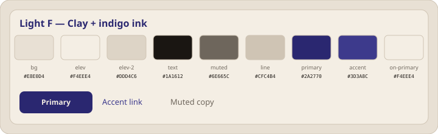

Studio clay, ink-indigo. **Pair:** Dark F.

---

### Light G — Mint wash + navy

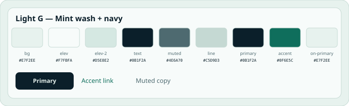

Tinted page, not white. **Pair:** Dark G.

---

### Light H — Sand + steel

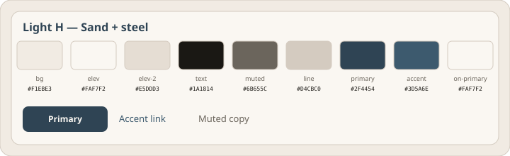

Warm sand, cool steel. **Pair:** Dark H.

---

## Dark

### Dark A — Warm black + indigo

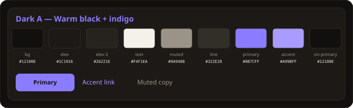

Brown-black, electric indigo. **Pair:** Light A.

---

### Dark B — Olive night + lime

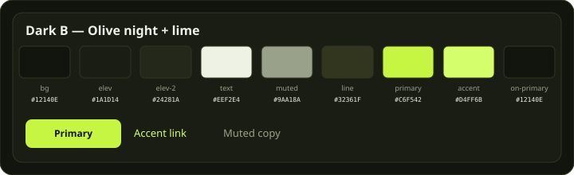

Green-black, lime light. **Pair:** Light C.

---

### Dark C — Bone on black

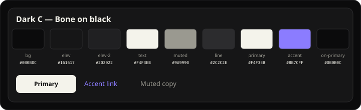

Ivory buttons, indigo links. **Pair:** Light A.

---

### Dark D — Tide

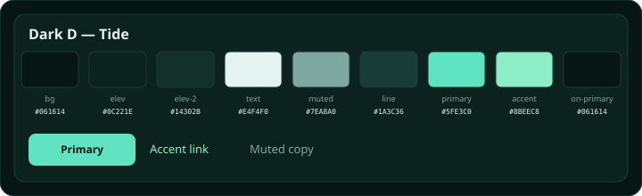

Green-black water, sea-glass. **Pair:** Light D.

---

### Dark E — Wine night

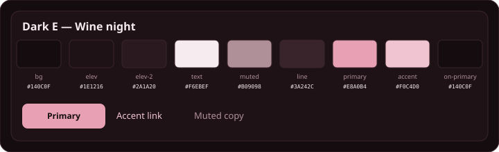

Plum black, dusty rose. **Pair:** Light E.

---

### Dark F — Eggplant

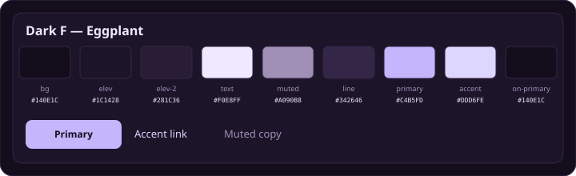

Violet-black studio. **Pair:** Light F.

---

### Dark G — Forest dim

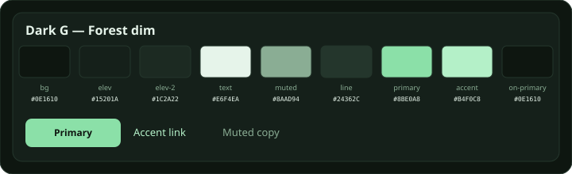

Night canopy. **Pair:** Light B.

---

### Dark H — Steel night

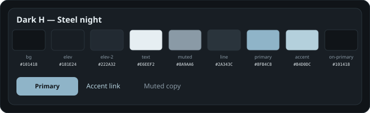

Instrument grey, no neon. **Pair:** Light H.
